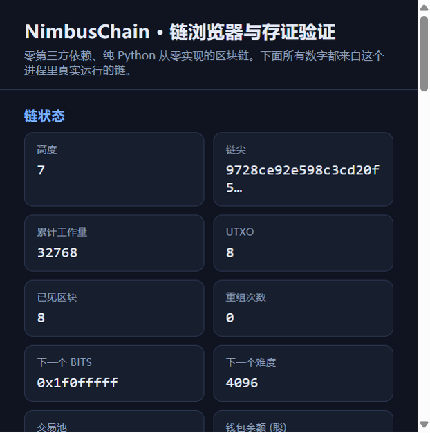
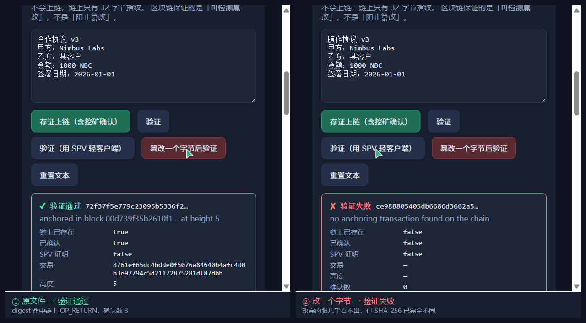
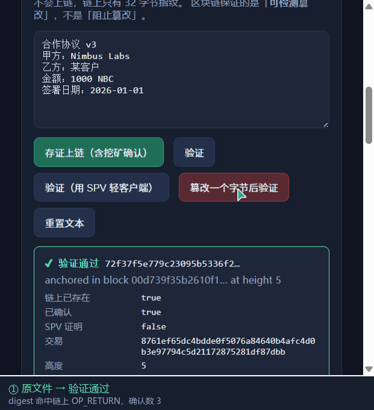
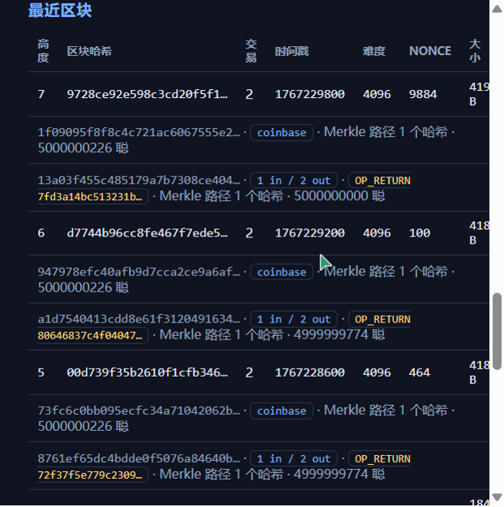
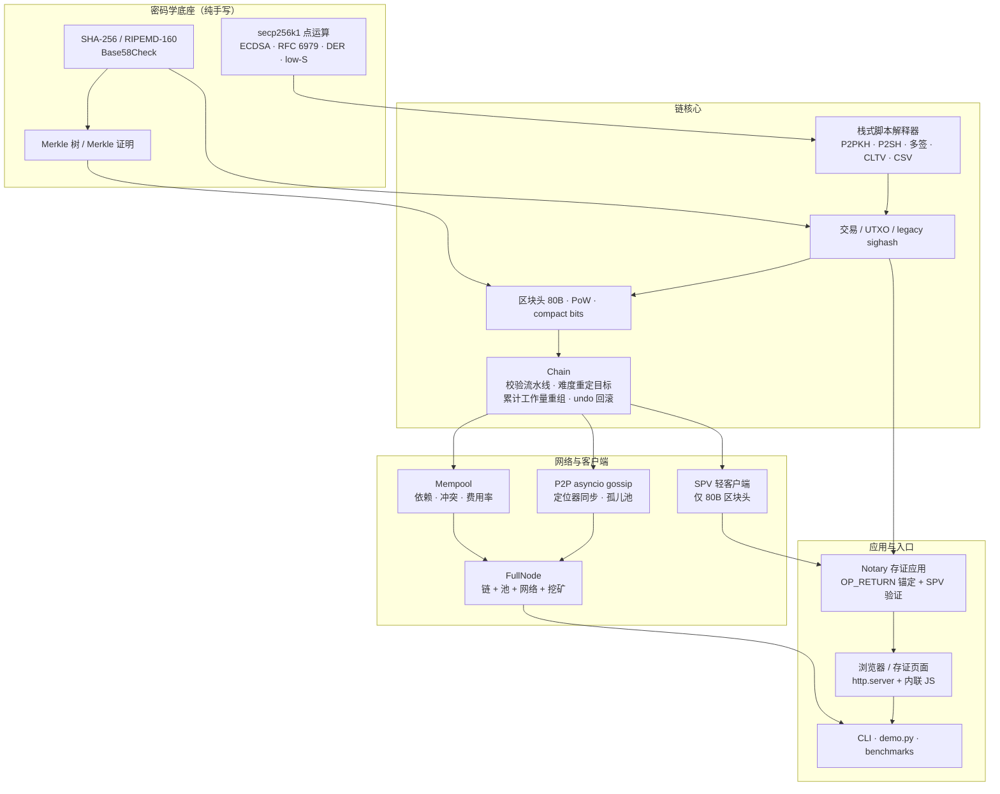

# NimbusChain

[](https://github.com/EAnge1o/nimbus-chain/actions/workflows/ci.yml)
[](https://python.org/)
[](https://docs.python.org/3/library/)
[](#测试)
[](LICENSE)

**NimbusChain** 是一个**零第三方运行时依赖**、从零实现的区块链。SHA-256、RIPEMD-160、
secp256k1 椭圆曲线、ECDSA（含 RFC 6979 确定性 nonce 与 DER 编解码）、Base58Check、
Merkle 证明、栈式脚本解释器、UTXO、PoW 与难度重定目标、按累计工作量的分叉重组、
SPV 轻客户端、P2P gossip —— 全部手写，只使用 Python 标准库。

它不满足于「能挖矿、能转账」：本项目要证明的是**共识规则可以被清晰地构建、测试和
讲解**，并且能在这条链之上跑一个真实可用的应用（文档存证与验证）。

> A from-scratch blockchain in pure Python — secp256k1 ECDSA with RFC 6979, Merkle proofs,
> a real script interpreter, proof-of-work with work-based reorganisation, an SPV light
> client, asyncio P2P gossip, and a tamper-evident notarisation application.
> **Zero third-party dependencies.**



*（截图是页面真实运行的结果，不是设计稿；链上 8 个区块、3 条存证记录都真实存在。）*

### 30 秒看懂这个项目

| 你可能想知道 | 直接看这里 |
|---|---|
| 能跑起来吗？ | `python -m unittest discover -s tests -t . -v` —— 349 个用例，约 16 秒，**不需要 pip install** |
| 核心机制在哪演示？ | `python demo.py` —— 50 项断言当场自校验：重组、难度钳制、篡改检测一次看完 |
| 那个应用长什么样？ | 上图；或 `python -m nimbus_chain serve --open` 自己点一遍 |
| 最硬的技术点是什么？ | 按**累计工作量**（而非链长）重组、真 sighash + 栈式脚本解释器、SPV 独立重算难度 —— 见 [docs/design.md](docs/design.md) |
| 会不会是抄的/包装的？ | 密码学原语全部手写，并与 NIST / RIPEMD / RFC 6979 官方向量**逐字节**比对 —— 见 [docs/competition.md](docs/competition.md) |

**存证应用的核心命题：改一个字节，肉眼几乎看不出，但链上再也验不过。**





---

## 两分钟现场演示

一条命令，50 项断言全部当场验证：

```bash
python demo.py
```

演示里最有说服力的两段（真实输出，非手写）：

```
5. 分叉重组：比的是累计工作量，不是链有多长
----------------------------------------------------------------------
  分支 A 高度               4
  分支 A 累计工作量            20480
  分支 A 每块难度             0x1f0fffff
  [✔] 该交易此时已在 A 中确认（高度 2，链尖高度 4）
  分支 B 第 1 块状态          side_chain
  分支 B 第 2 块 bits       0x1f03ffff          ← 时间戳只隔 1 秒，触发 4 倍变难
  分支 B 预计累计工作量          24576
  [✔] 分支 B 更短（2 块）但累计工作量更高
  加入分支 B 的结果            reorg
  重组后高度                 2
  [✔] 主链更短但工作量更大
  [✔] 被挤出主链的交易被交还给调用方
  [✔] 增量 UTXO 集与全量重放完全一致

6. 存证应用：把文件摘要锚定上链，篡改必然暴露
----------------------------------------------------------------------
  [✔] 摘要大小恰好 32 字节（链上不存文件本体）
  [✔] 交易里带一个 OP_RETURN 输出，载荷就是摘要
  [✔] 原文件验证通过
  [✔] 改一个字节就无法通过验证
  [✔] 只翻转 1 个 bit 也会被发现

7. SPV 轻客户端：只靠区块头 + Merkle 路径就能验证交易
----------------------------------------------------------------------
  轻客户端本地存储              320 字节（80 × 4）
  全节点需要存储               1003 字节
  [✔] Merkle 证明成立
  [✔] 篡改路径中的任一哈希 => 证明失败
  [✔] SPV 验证与全节点结论一致
```

浏览器里还有一条更直观的演示路径：`python -m nimbus_chain serve --open`，
页面上点「存证上链」→「验证」→「篡改一个字节后验证」，红色失败会当场出现
（上面那两张对比图就是这么来的）。

链上数据也是直接看得见的——每个区块的交易、`OP_RETURN` 载荷与 Merkle 路径长度都会列出来：



## 为什么是它

仓库里已经有了从零实现的系统底座（`nimbus-kv` 的 Raft 一致性、`nimbus-db` 的 SQL
引擎与 WAL、`nimbus-git` 的内容寻址、`nimbus-vm` 的字节码虚拟机）和应用层项目
（RAG 学习助手、面试陪练、校园交易平台）。**缺的是「密码学 + 分布式账本」这一块**，
而它恰恰是评委最容易追问、也最难含糊过去的领域。

更关键的是：区块链项目最容易做成"调用 `web3.py` 发一笔交易"。这个仓库反过来，
把**链本身**当作研究对象——不留任何一行第三方库可以藏身的地方。

## 功能特性

### 密码学（`nimbus_chain/crypto.py`、`secp256k1.py`）
- **纯 Python SHA-256**：消息填充、64 步压缩函数、轮常量全部手写；与 `hashlib`
  在 55/56/63/64/119/120 等填充边界上逐字节一致（并保留 `hashlib` 快路径供挖矿使用）。
- **纯 Python RIPEMD-160**：不依赖 `hashlib.new('ripemd160')`——该算法在部分
  OpenSSL 构建里已被移出默认 provider，跨平台不可靠；公钥哈希路径不能靠运气。
- **secp256k1 ECDSA**：Jacobian 坐标点运算（只在最后转仿射时做一次模逆）、
  **RFC 6979 确定性 nonce**、严格 DER 编解码、**low-S 归一化**（BIP 62）、
  公钥压缩/解压。签名对同一密钥与消息**逐字节可复现**——彻底消灭"随机数复用泄露私钥"。
- **Base58Check**：版本字节 + 双 SHA-256 前 4 字节校验和，创世地址与官方向量一致。

### Merkle 与脚本（`merkle.py`、`script.py`）
- **Merkle 树与 Merkle 证明**：奇数叶复制（Bitcoin 规则，不是补零）、路径生成与验证、
  篡改任意一叶或路径任一哈希都会失败。
- **真正的栈式脚本解释器**：`OP_PUSHDATA1/2/4` 与最小推送编码、CScriptNum 数值编码、
  完整条件分支语义（未生效分支里的 `IF` 不弹栈）、算术/比较/哈希/栈操作 opcode。
- **P2PKH / P2SH / 多签 / OP_RETURN / CLTV / CSV**。P2SH 走**两阶段**执行
  （先验 redeem script 哈希，再以它为 scriptCode 执行）；多签连 `OP_CHECKMULTISIG`
  那个著名的 **off-by-one 弹栈 bug** 都如实兼容。时间锁按 5 字节解码
  （`1 << 31` 的 sequence 禁用位必须用 5 字节最小化表示）。

### 交易与区块（`tx.py`、`block.py`）
- **UTXO 模型**：字节级序列化、varint、**legacy sighash**（清空全部 scriptSig、
  把当前输入的 scriptCode 填回、拼上 4 字节 hash 类型）。
- **coinbase 与减半**：BIP34 区块高度、`50 NBC >> (height / 210000)`。
- **80 字节区块头**：`version | prev_block | merkle_root | timestamp | bits | nonce`。
- **compact bits ↔ target 双向转换**：拒绝负数尾数与溢出（`target >= 2^256`）。

### 共识（`chain.py`）
- **完整校验流水线**：父块存在、PoW 达标、难度 `bits` 与规则一致、时间戳大于过去
  11 个区块的**中位数**（MTP）、Merkle 根匹配、区块内无重复交易、非 coinbase 输入
  能在 UTXO 里找到、签名通过、**coinbase 不超发**（补贴 + 手续费）、**coinbase 成熟度**。
- **难度重定目标**：每 `retarget_interval` 块按窗口首尾时间戳差调整，**4 倍钳制**，
  且不松于 `pow_limit`。全节点与轻客户端**共用同一份实现**
  （`block.compute_retarget_bits`）——各写一份迟早会因为钳制顺序不同而静默分叉。
- **按累计工作量（而非高度）选择主链**：`block_work = 2^256 / (target + 1)`。
  **短而高难度的分支可以击败长而低难度的分支**，这是本项目的核心命题之一。
- **精确重组**：每个已连接的块保存 undo 记录（花了哪些 UTXO、新建了哪些 UTXO）。
  重组时逐块断开并还原，再把新分支逐块连上；被挤出主链的非 coinbase 交易**交还给
  调用方**（交给交易池）。
- **两条路径互相印证**：扩展链尖用增量 UTXO 集，验证分叉块用**全量重放**算出的
  UTXO 集；测试断言两者在所有情况下完全一致。
- **区块内唯一 coinbase**：同高度、同收款地址的两个竞争区块必须产生不同的
  coinbase 交易，否则交易索引会撞车、确认数会算错——靠 `unique_extra_nonce` 解决。
- **持久化**：主链序列化为可读 JSON（教学项目刻意不选二进制）。

### 交易池与钱包（`mempool.py`、`wallet.py`）
- **依赖与冲突**：一笔交易可以花另一笔「还在池子里」的交易输出；打包顺序必须是
  **拓扑序**，父交易被剔除时子交易一起走；同一个 outpoint 只能被池中一笔交易花掉。
- **费用率排序**：按 `fee / size`（聪/字节），不是绝对手续费。
- **区块同步**：新区块接入后 `refresh()` 按依赖顺序重校验全部条目；重组后被挤出的
  交易 `re_add` 回池。
- **钱包**：Base58Check 地址、largest-first 选币、按字节数预估手续费、
  **粉尘找零并入手续费**（不造花不掉的输出）、P2PKH 签名。

### 网络与轻客户端（`p2p.py`、`node.py`、`spv.py`）
- **asyncio 长度前缀 JSON gossip**：`hello / inv / getdata / block / tx / getblocks / blocks`。
  只广播"我有这个哈希"，对方缺什么再按需索取。
- **区块定位器（block locator）**：从链尖往回按指数步长取样，双方据此找出**第一个
  共同祖先**——这是发现"同高度但不同分支"的对端所必需的机制（只比高度会永远发现不了）。
- **孤儿池**：父块还没到的区块先挂起并主动索取父块，父块到位后**递归解开**；
  进池前**先验 PoW**，否则任何人都能用垃圾块把内存灌满。
- **SPV 轻客户端**：只保存 80 字节区块头，**独立重算难度与 MTP**（不采信对端），
  用 Merkle 证明验证交易存在性。

### 应用层（`notary.py`）
- **文件存证与验证**：把 `SHA-256(文件内容)` 写进 `OP_RETURN` 输出（链上只存 32 字节，
  不存文件本体）；验证时把「未找到 / 仅在交易池 / 已确认 / SPV 也验过」**区分开**——
  一个只回答 true/false 的接口会掩盖这些关键差别。
- **边界诚实**：区块链保证的是「**可检测**篡改」，不是「阻止篡改」。措辞上绝不声称"防篡改"。

### 演示与工具（`server.py`、`cli.py`、`demo.py`）
- **浏览器页面**：标准库 `http.server` + 内联 HTML + 原生 JS，**零前端构建、零 CDN**，
  断网可跑。含链浏览、存证验证、SPV 与全节点存储量对比。
- **CLI**：`info / address / mine / balance / send / notarize / verify / anchors / spv / serve / node`。
- **自校验演示**：`python demo.py` 打印 8 段结论并**当场断言**，最后统计通过数量。

## 快速开始

要求 Python 3.10+，**无需安装任何第三方依赖**（连 `pip install` 都不需要）。

```bash
# 1) 跑完整测试套件（349 个用例）
python -m unittest discover -s tests -t . -v

# 2) 一条命令看完整个项目（含 50 项自断言）
python demo.py

# 3) 浏览器 + 存证验证页面（零前端构建）
python -m nimbus_chain serve --open
```

用 CLI 自己走一遍（数据落在 `./nimbus-data`）：

```bash
# 演示参数：coinbase 成熟度设为 1，否则要等 100 块才能花（默认值就是 100，与 Bitcoin 一致）
python -m nimbus_chain --data-dir demo-data --coinbase-maturity 1 mine --count 3
python -m nimbus_chain --data-dir demo-data --coinbase-maturity 1 address
python -m nimbus_chain --data-dir demo-data --coinbase-maturity 1 balance

# 存证上链 + 用 SPV 轻客户端验证
python -m nimbus_chain --data-dir demo-data --coinbase-maturity 1 \
    notarize --text "the quick brown fox" --mine
python -m nimbus_chain --data-dir demo-data --coinbase-maturity 1 \
    verify --text "the quick brown fox" --spv
# 改一个字符再验：必然失败
python -m nimbus_chain --data-dir demo-data --coinbase-maturity 1 \
    verify --text "the quick brown f0x"

# 看轻客户端有多省
python -m nimbus_chain --data-dir demo-data --coinbase-maturity 1 spv
```

起两个真实节点，看它们自己收敛（开两个终端）：

```bash
python -m nimbus_chain --data-dir node1 --coinbase-maturity 1 \
    node --name n1 --port 8001 --mine --interval 2
python -m nimbus_chain --data-dir node2 --coinbase-maturity 1 \
    node --name n2 --port 8002 --peer 127.0.0.1:8001
```

在代码里直接用：

```python
from nimbus_chain.chain import Chain, ChainParams
from nimbus_chain.wallet import Wallet
from nimbus_chain.notary import Notary
from nimbus_chain.secp256k1 import PrivateKey
from nimbus_chain.spv import SPVClient

chain = Chain(ChainParams(coinbase_maturity=1))
miner = Wallet(name="miner", keys=[PrivateKey(0xF00D)])
alice = Wallet(name="alice", keys=[PrivateKey(0xA11CE)])

for _ in range(2):                                   # 挖两个块给矿工
    chain.add_block(chain.build_and_mine([], miner.first_script()))

tx = miner.send(chain, alice.address(), 1_000_000)   # 构造并签名一笔转账
chain.add_block(chain.build_and_mine([tx], miner.first_script()))

notary = Notary(chain, miner)
notarization = notary.notarize(b"contract v3")       # 把摘要写成 OP_RETURN
chain.add_block(chain.build_and_mine([notarization.tx], miner.first_script()))

print(notary.verify(b"contract v3").valid)           # True
print(notary.verify(b"contract v4").valid)           # False（内容变了）

client = SPVClient(chain.params)
client.sync_from_chain(chain)                        # 只同步区块头
print(notary.verify(b"contract v3", spv=client).spv_verified)   # True
```

## 架构



一次「写一笔交易」经过的完整路径：

```
Wallet.create_transaction → 选币 → 构造输入/输出/找零
  → Tx.sighash(script_code) → 想定 nonce → ECDSA 签名 → DER → P2PKH scriptSig
  → Mempool 预校验（依赖/冲突/脚本/费用率）
  → Miner 按拓扑序 + 费用率打包 → coinbase 收拢手续费 → Merkle 根 → PoW
  → Chain 校验流水线 → 连上主链（增量 UTXO + undo）
  → P2P 广播 inv → 对端 getdata → 对端独立校验后接上
```

## 目录结构

```
nimbus-chain/
├── nimbus_chain/
│   ├── crypto.py       # 纯 Python SHA-256 / RIPEMD-160 / Base58Check，附带 hashlib 快路径
│   ├── secp256k1.py    # 曲线点运算、ECDSA、RFC 6979、DER、low-S、公钥压缩
│   ├── merkle.py       # Merkle 树与 Merkle 证明
│   ├── script.py       # 栈式脚本解释器（P2PKH/P2SH/多签/OP_RETURN/CLTV/CSV）
│   ├── tx.py           # 交易序列化、UTXO、legacy sighash、coinbase 与减半
│   ├── block.py        # 区块头/区块、PoW、compact bits、共享的难度重定目标规则
│   ├── chain.py        # 校验流水线、重组、undo 回滚、UTXO 集、持久化
│   ├── mempool.py      # 交易池：依赖拓扑序、冲突、费用率排序、区块同步
│   ├── wallet.py       # 密钥/地址、选币、粉尘找零、P2PKH 签名
│   ├── p2p.py          # asyncio gossip、区块定位器同步、孤儿池
│   ├── node.py         # FullNode：链 + 池 + 网络 + 挖矿
│   ├── spv.py          # SPV 轻客户端：独立重算难度 + Merkle 证明
│   ├── notary.py       # 存证应用：OP_RETURN 锚定 + 带证据的验证结论
│   ├── server.py       # 浏览器 / 存证验证页面（http.server，零构建）
│   ├── cli.py          # 命令行入口
│   ├── __init__.py     # 模块地图
│   └── __main__.py     # python -m nimbus_chain
├── tests/              # 13 个测试文件，349 个用例
├── benchmarks/
│   ├── bench_crypto.py # 纯 Python vs hashlib、ECDSA/脚本验证耗时
│   └── bench_pow.py    # 挖矿速率、难度对照表、区块验证吞吐、存储量对比
├── demo.py             # 自校验端到端演示（50 项断言）
├── docs/
│   ├── design.md       # 分层设计、数据结构、sighash/重组/难度细节
│   ├── competition.md  # 答辩材料：定位、创新点、证据、演示脚本、追问应答
│   ├── screenshot-explorer.png        # 浏览器页面（真实截图，非设计稿）
│   ├── screenshot-verify-vs-tamper.png  # 原文件通过 vs 改一个字节后失败
│   ├── screenshot-blocks.png          # 区块与存证记录列表
│   └── demo-notarize.gif              # 存证 → 篡改 → 验证失败的动画
├── .github/workflows/ci.yml   # Ubuntu + Windows × Python 3.10/3.12/3.13
├── pyproject.toml
└── LICENSE
```

## 测试

```bash
python -m unittest discover -s tests -t . -v
# Ran 349 tests in ~16s  —— OK
```

覆盖范围（每个文件都对应一组可被追问的命题）：

| 测试文件 | 用例 | 证明的命题 |
|---|---|---|
| `test_crypto.py` | 14 | SHA-256 正确且与 `hashlib` 逐字节一致（含 55/56/63/64/119/120 填充边界）；RIPEMD-160 匹配 8 组官方向量；Base58Check 校验和能发现 1 个字符改动 |
| `test_secp256k1.py` | 37 | 2G/3G 已知点与群律自洽；**RFC 6979 命中 Satoshi Nakamoto 向量**；改 1 个 bit 验签失败；low-S 归一化；DER 严格解析（非最小编码/负数/尾部多余字节全部拒绝） |
| `test_merkle.py` | 13 | 奇数叶复制规则；路径对全部索引与多种规模成立；篡改叶/篡改路径/改方向全部失败 |
| `test_script.py` | 43 | CScriptNum 边界；条件分支正确（未生效分支里的 `IF` 不弹栈）；P2PKH 正例与错签名/错哈希；**多签含 off-by-one** 与顺序要求；P2SH 错 redeem 脚本被拒；CLTV/CSV 含类型不匹配与禁用位 |
| `test_tx.py` | 32 | 序列化往返；txid 变化；sighash 会清空其他输入脚本；不支持的 hash 类型被拒；减半；coinbase scriptSig 长度；双花/无输出/超发被拒 |
| `test_chain.py` | 45 | 校验流水线逐项拒绝（PoW/bits/Merkle/MTP/重复交易/超发/未成熟 coinbase/双花/脚本）；**4 倍钳制的上下界**；**真实重组：短而高工作量击败长而低工作量**；重组后 UTXO 精确回滚；**增量 UTXO == 全量重放**；持久化往返 |
| `test_mempool.py` | 27 | 依赖（子交易等父交易）；冲突；费用率排序；字节预算；父交易未入选时子交易跳过；区块接入后清理；`re_add` 只接受仍有效的交易 |
| `test_wallet.py` | 29 | 地址编解码与校验和；选币覆盖金额+手续费；粉尘找零并入手续费；丢签名被链拒绝；三钱包链式转账端到端 |
| `test_spv.py` | 25 | 轻客户端**独立重算的每个高度 bits 与全节点一致**；错误 PoW/难度/时间戳/非连续头全部拒绝；**多交易区块的真实 Merkle 路径**；篡改路径/跨区块冒名/未知区块头全部失败 |
| `test_notary.py` | 26 | 摘要就是 `SHA-256`；OP_RETURN 载荷正确；**改一字节/翻一个 bit 验证必失败**；区分「未找到 / 仅在交易池 / 已确认」；SPV 验证与全节点结论一致；未同步的轻客户端无法独立证实 |
| `test_p2p.py` | 19 | **真实 TCP 双节点同步**；交易传播与经第三个节点**中转**；**孤儿块挂起与递归解开**；无效 PoW 永不入孤儿池；**同高度不同分支用定位器互相发现**；**分叉按累计工作量重组**；不同创世块的网络被断开；重复 stop 安全 |
| `test_server.py` | 33 | 真实启动 HTTP 服务并请求全部端点；存证→验证→篡改三连；SPV 证明端点；无钱包时返回 503；404/400/413 与 HEAD 行为 |
| `test_console.py` | 6 | **在 `PYTHONIOENCODING=cp1252` 的子进程里跑 `demo.py` 与 CLI**：复现并挡住「CI 上 Windows 因非 UTF-8 控制台抛 `UnicodeEncodeError`」这个真实事故 |

## 性能基准

本机实测（Windows / Python 3.13，数值随机器变化）：`python benchmarks/bench_crypto.py`

```
操作                              纯 Python          hashlib / 参考        倍率
------------------------------------------------------------------------------
sha256 单次（86 B）                3,413 次/秒         1,650,769 次/秒    483.6x
sha256 吞吐                      0.28 MB/s            135.4 MB/s    483.6x
sha256d（80 B 区块头）                      —           833,039 次/秒         —
ripemd160（86 B）                4,590 次/秒           668,027 次/秒         —
secp256k1 标量乘 k·G              6,335 次/秒             0.16 ms/次         —
ECDSA 签名（RFC 6979）               700 次/秒             1.43 ms/次         —
ECDSA 验签                         320 次/秒             3.12 ms/次         —
Base58Check 编码               196,894 次/秒                     —         —
Merkle 根（4096 叶）                 213 次/秒          路径 206 次/秒         —
完整 P2PKH 输入验证                    315 次/秒             3.17 ms/次         —
多签 2-of-3 输入验证                   106 次/秒             9.40 ms/次         —
```

`python benchmarks/bench_pow.py`

```
一、难度对照表（compact bits → 目标值 → 期望哈希次数）
        bits          期望哈希次数        难度倍数
     0x1f0fffff           4,096        1.0x      ← 本项目演示难度（pow limit）
     0x1f03ffff          16,384        4.0x      ← 一次 4 倍钳制后的难度
     0x1d00ffff   4,295,032,833  1048591.0x      ← Bitcoin 主网难度

三、实际挖矿（空块，逐难度）
     0x1f0fffff         4,096         6,945      13.4 ms  →  成功
     0x1f03ffff        16,384        15,893      28.9 ms  →  成功

四、区块验证吞吐
  区块大小 / 交易数 / 输入数     1311 B / 6 / 6
  完整校验（含全部签名验证）     18.12 ms/块  =>  55 块/秒
  折算单个输入                   3.02 ms/输入

五、存储量对比（同一份信任，两种节点）
  全节点（全部区块）             1,320 B
  SPV 轻客户端（仅区块头）       560 B（7 个区块头）
  轻客户端占比                   42.42%
```

**怎么读这些数字**（诚实版）：

- 纯 Python SHA-256 比 `hashlib` 慢约 **480 倍**。所以挖矿与批量哈希默认走快路径，
  而纯实现保留下来**用于交叉验证**——这才是它的价值：一份可以逐字节比对的标准答案。
- **secp256k1 没有标准库替代品**，只能手写；毫秒级的签名/验签完全够用，
  单笔 P2PKH 验证约 3.17 ms。
- 演示难度下挖矿只要十几毫秒，于是**验证反而成了大头**（6 个输入 ≈ 18 ms）。
  这恰好说明 PoW 的本质：难度每翻一倍，挖矿成本翻倍，而**验证成本与难度无关**。
  换成 Bitcoin 主网的 `0x1d00ffff`，挖矿期望次数会放大 100 万倍，验证依然毫秒级。
- SPV 占比 42% 是因为演示链只有 7 个块、每个块里只有 1~6 笔交易；区块越多、
  交易越密，这个比例会趋近于 0.01% 量级。

## 与同类项目对比

| 项目 | 语言 | 运行时依赖 | 脚本解释器 | 难度调整 | 主链选择依据 | SPV | P2P | 应用层 |
|---|---|---|---|---|---|---|---|---|
| 典型"200 行区块链"教程实现 | Python | 通常依赖 `ecdsa`/`hashlib` 封装 | ✗（只签 hash） | 简化或固定 | 链长 | ✗ | ✗ | ✗ |
| `python-bitcoinlib` / `pybitcointools` | Python | 依赖多个第三方库 | 部分封装 | 不涉及 | 不涉及 | ✗ | ✗ | ✗ |
| Bitcoin Core | C++ | 自带（体积巨大） | ✓ | ✓ | **累计工作量** | ✓ | ✓ | ✗ |
| **nimbus-chain** | **Python** | **无（仅标准库）** | **✓（P2PKH/P2SH/多签/CLTV/CSV）** | **✓（4 倍钳制）** | **累计工作量** | **✓** | **✓** | **✓ 存证验证** |

> 与 Bitcoin Core 的可比性有限（那是生产级实现，本项目是教学实现），
> 但在「脚本解释器 / 难度调整 / 工作量重组 / SPV」这四项上，二者遵循同一套规则。

## 竞赛答辩定位

**一句话**：一条零依赖、从零实现的区块链，共识规则全部可验证，并在其上跑了一个
真实可用的文档存证应用。

**四个技术纵深**

1. **密码学原语全部手写**，且与权威向量逐字节可比对：SHA-256 的填充边界、
   RIPEMD-160 的 8 组官方向量、secp256k1 的 2G/3G 已知点、**RFC 6979 的
   Satoshi Nakamoto 向量**。评委可以当场要求改一行代码看测试是否变红。
2. **真 sighash + 栈式解释器**，而不是"对哈希签个名"：脚本被执行、栈被操作、
   P2SH 两阶段执行、多签连 off-by-one 都兼容。
3. **按累计工作量重组**，而不是"最长链"：短而高难度的分支能击败长而低难度的分支；
   重组后 UTXO 精确回滚、被挤出的交易交还交易池，并且**增量集与全量重放永远一致**。
4. **轻客户端打通到应用层**：SPV 只存 80 字节区块头、独立重算难度，并用 Merkle
   证明给存证应用出具"这笔存证确实被某个区块承诺过"的结论。

**可验证性（现场可复现的命令）**

```bash
python -m unittest discover -s tests -t . -v         # 349 个用例
python demo.py                                       # 50 项断言，全程自校验
python benchmarks/bench_crypto.py                    # 纯实现 vs 快路径
python benchmarks/bench_pow.py                       # 难度对照 / 挖矿 / 验证吞吐
python -m nimbus_chain serve --open                  # 浏览器里现场"篡改一个字节"
```

**最容易被追问、也最容易翻车的三点**（`docs/competition.md` 里有完整的逐条应答）

1. **sighash 的序列化细节**：清空哪些脚本、填回哪个 scriptCode、拼什么后缀。
2. **重组回滚的 UTXO 与交易池还原**：为什么比的是累计工作量、coinbase 成熟度怎么处理。
3. **RFC 6979 / low-S / DER 的边界**：为什么确定性 nonce 是安全需求而非可选优化。

详见 [docs/design.md](docs/design.md) 与 [docs/competition.md](docs/competition.md)。

## 局限与边界（显示你知道边界在哪）

- **不是生产级实现**：不做 SegWit / Taproot、不做 RBF/CPFP、不实现签名缓存与区块
  weight；只支持 `SIGHASH_ALL`。
- **P2P 是简化版**：没有地址簿与节点发现（DNS seeds）、没有 getheaders 增量同步、
  没有限速与反女巫。这些是工程问题，不是共识问题。
- **挖矿在事件循环里跑**：演示规模（每块十几毫秒）尚可接受，代价是这个间隙内 P2P
  会短暂停顿；生产实现应当把 PoW 放到独立进程。
- **持久化是可读 JSON**：为教学可读性牺牲了性能；真实实现应当用页面文件 + WAL
  （这一块可参考本仓库的 `nimbus-db`）。
- **难度参数是演示级**：`pow_limit = 0x1f0fffff`（期望约 4096 次哈希），
  不是主网参数。改 `--target-block-time` / `retarget_interval` 即可观察不同行为。
- **存证只保证"可检测篡改"**：文件本身仍可被修改，只是改完再也验不过；
  链上不存文件内容，因此**不解决文件丢失问题**。

## License

[MIT](LICENSE)
